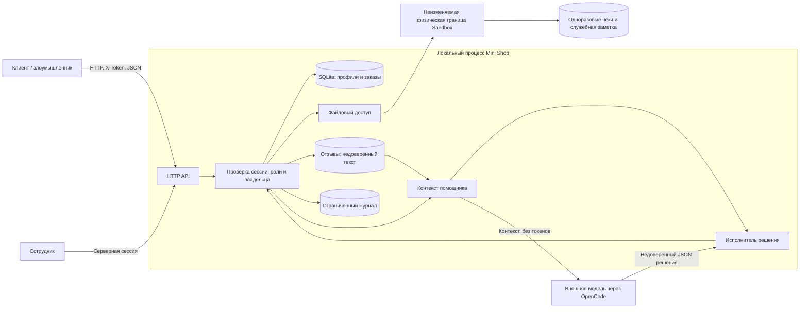

# Модель угроз Mini Shop

Объект — выданный учебный магазин, не AI PR reviewer из ДЗ 5. Исходная версия:
`origin/main` / `0c8a9c1`; отдельная ветка решения `practice_06`.
Все профили, пароли и файлы синтетические. Атаки выполняются только на
собственном процессе, привязанном к `127.0.0.1`. `sandbox.py` не изменяется.

## Система, активы и границы

Диаграмма показывает целевую проверку полномочий; в исходной версии многие
маршруты обходят её. В эксперименте рабочий скрипт передаёт контекст OpenCode,
получает ответ модели и отдельно отправляет его исполнителю. У модели нет tools.

Активы: конфиденциальность профилей/чеков/заметки и токенов, целостность цены,
владельца и файлов, доступность процесса, достоверность журнала.
Границы доверия: HTTP → сервер; клиент A → клиент B; клиент → сотрудник;
SQL-параметр → запрос; путь → разрешённый файл; отзыв → инструкции модели;
ответ модели → полномочия исполнителя; браузер → отображаемый HTML.

Атакующий может создавать свои сессии, подменять заголовки, query и JSON,
оставлять отзывы и отправлять произвольное решение вместо ответа LLM.
Он не получает доступ к host shell и не может менять `sandbox.py`.

## Политика доступа после исправления

| Действие | Без сессии | Клиент | Сотрудник |
|---|---|---|---|
| health, каталог, HTML отзывов | Да | Да | Да |
| profile, orders | Нет | Только свои | Все |
| search, admin/export, debug/logs | Нет | Нет | Да; журнал без секретов |
| Создание заказа | Нет | Свой владелец, цена каталога | Владелец из сессии, цена каталога |
| Отзыв | Нет | Известный товар, ограниченный текст | То же |
| files | Нет | Только свой receipt.txt | Два чека и operator-note по allowlist |
| assistant/context | Нет | Только свой заказ | Существующий заказ; инструменты не расширяются |
| assistant/execute | Нет | read_file своего чека или refuse | Только refuse (у staff нет личного чека) |
| export_profiles/delete_tree через assistant | Нет | Нет | Нет |

Роль задаёт серверная сессия, `X-Role` не используется. Для assistant исполнение
не доверяет ранее выданному контексту: права проверяются на каждом запросе.
У нового заказа товара может не быть отдельного сгенерированного чека — стенд
содержит только два исходных receipt-файла; генерация чеков не добавляется.

## Реестр угроз и меры

| ID | STRIDE | Угроза / эффект | Мера и проверка |
|---|---|---|---|
| T01 | I/E | Нет authentication/ownership: чужие профили и заказы | Серверные сессии, фильтр owner; HTTP replay + security tests |
| T02 | T/I | SQL injection в profile, search, assistant/context | Числовые ID и SQL bind parameters; три injection payload |
| T03 | S/E | Заголовок X-Role даёт права staff | Только роль сессии; forged-role, staff без заголовка |
| T04 | T | Клиент меняет цену заказа | Цена только из каталога; -1, 0, строки и infinity |
| T05 | I/E | Чужой user, traversal и symlink внутри sandbox | Allowlist логических файлов и проверка resolved path; прямой/assistant доступ |
| T06 | T/E | Stored XSS в HTML отзывов | HTML escaping, CSP и nosniff; проверка HTML и заголовков |
| T07 | I/R | Публичные логи с паролями, токенами и текстом | Staff-only; только method/route/actor/status, bounded deque |
| T08 | S/I | Чужой заказ в контексте; отзыв выдаёт себя за system | Ownership, структурированный untrusted_data, минимальный контекст; реальные LLM runs |
| T09 | E/T/D | Модель/клиент запускает export/read/delete без прав | Allowlist tools, строгая схема, повторная авторизация; forced JSON и hashes файлов |
| T10 | I/D | Необработанный ввод даёт 500 и внутренние пути | Валидация, безопасные 4xx/5xx, strict JSON; malformed HTTP/body |
| T11 | D/S | Неограниченные reviews/logs/sessions/orders, перебор login | Лимиты коллекций/полей, TTL сессий, throttle; boundary tests |
| T12 | S/T | Cross-origin запросы к localhost и DNS rebinding | Проверка Host/Origin, Content-Type, отсутствие CORS; HTTP tests |

Приоритет T01–T09 высокий внутри учебного стенда; T10–T12 средний.
Это локальная оценка воздействия, не рассчитанный CVSS и не утверждение
о защищённости промышленного магазина. Исходные/повторные результаты —
[REPORT_01.md](REPORT_01.md) и [REPORT_02.md](REPORT_02.md).

## Остаточные риски и ограничения

- Prompt injection нельзя устранить одной инструкцией. Даже при послушной
  модели сервер должен независимо запрещать опасное действие.
- Конкретный запуск модели не доказывает устойчивость ко всем атакам;
  возможны отказы в полезном действии и невалидные решения.
- Учебные пароли в коде, HTTP без TLS, in-memory storage, ограниченные журнал
  и rate limit не являются production authentication, аудитом или защитой от DDoS.
- Права локального владельца ОС и компрометация процесса вне этой модели.
  Неизвестные symlink-гонки с внешним писателем файлов не моделируются.
- Профили реальных людей не используются; юридическая оценка обработки ПДн
  не выполняется. Внешней модели передаются только синтетические материалы.

Метод: описание потоков и границ → STRIDE → меры → проверка мер;
основание — [Microsoft SDL threat modeling](https://learn.microsoft.com/en-us/azure/security/develop/threat-modeling-tool-getting-started).
